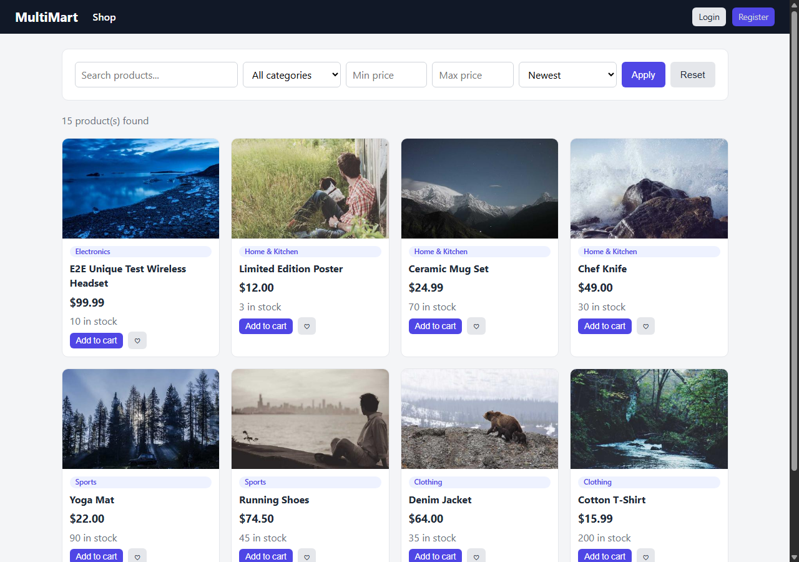
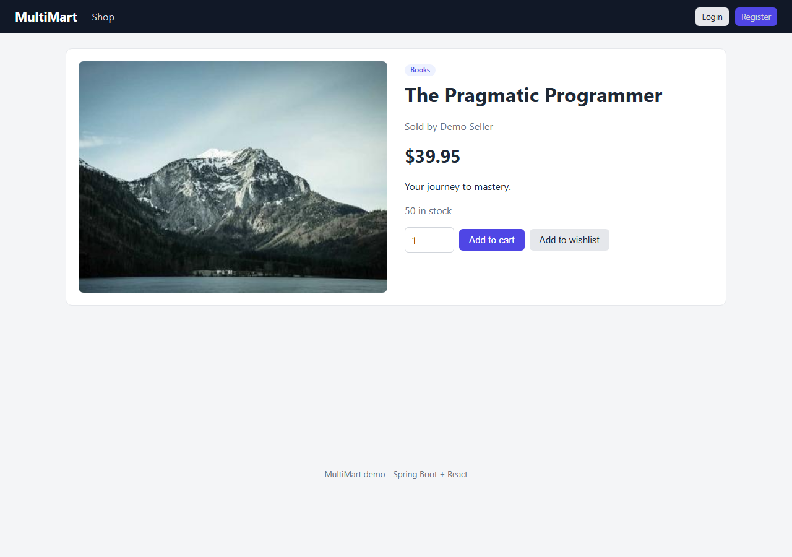
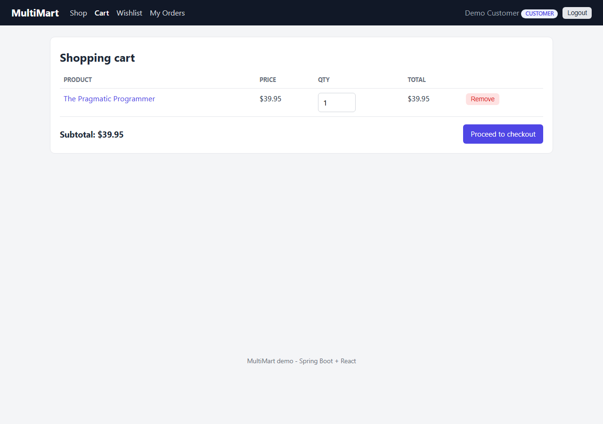
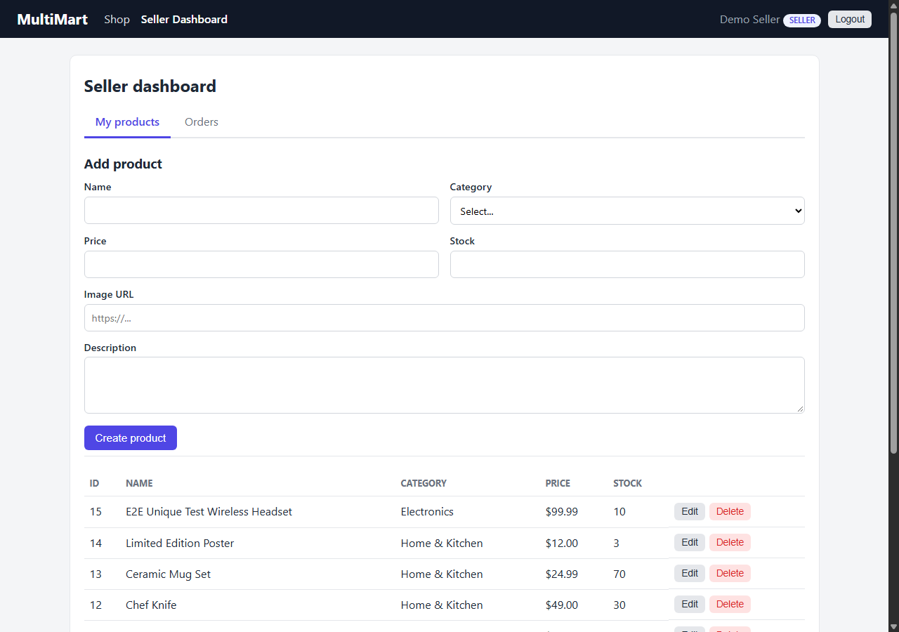
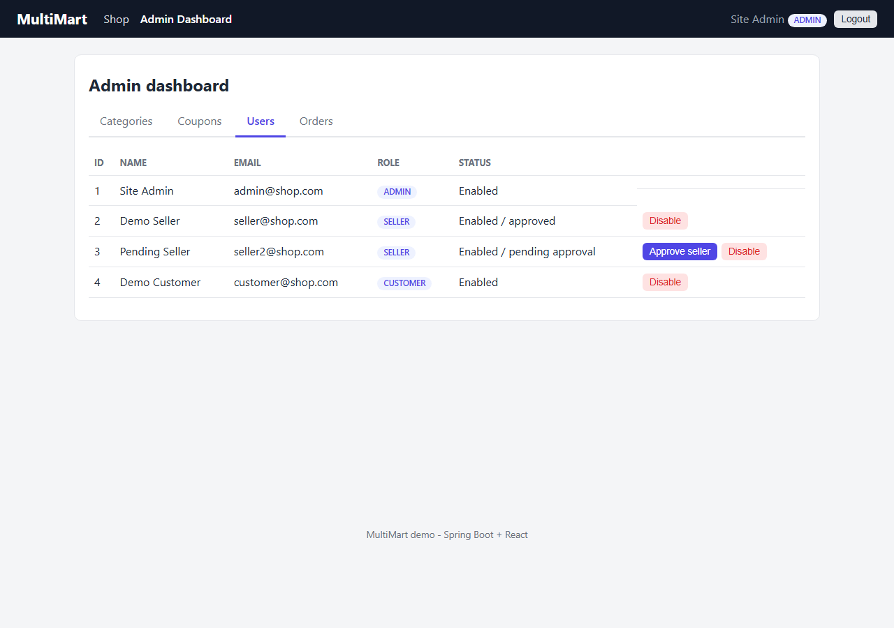
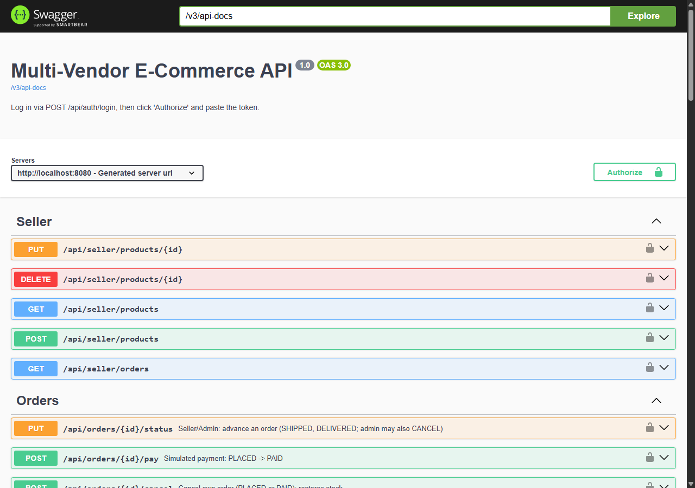
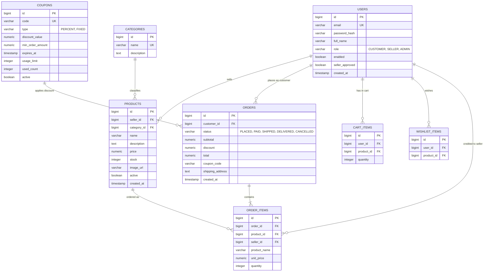
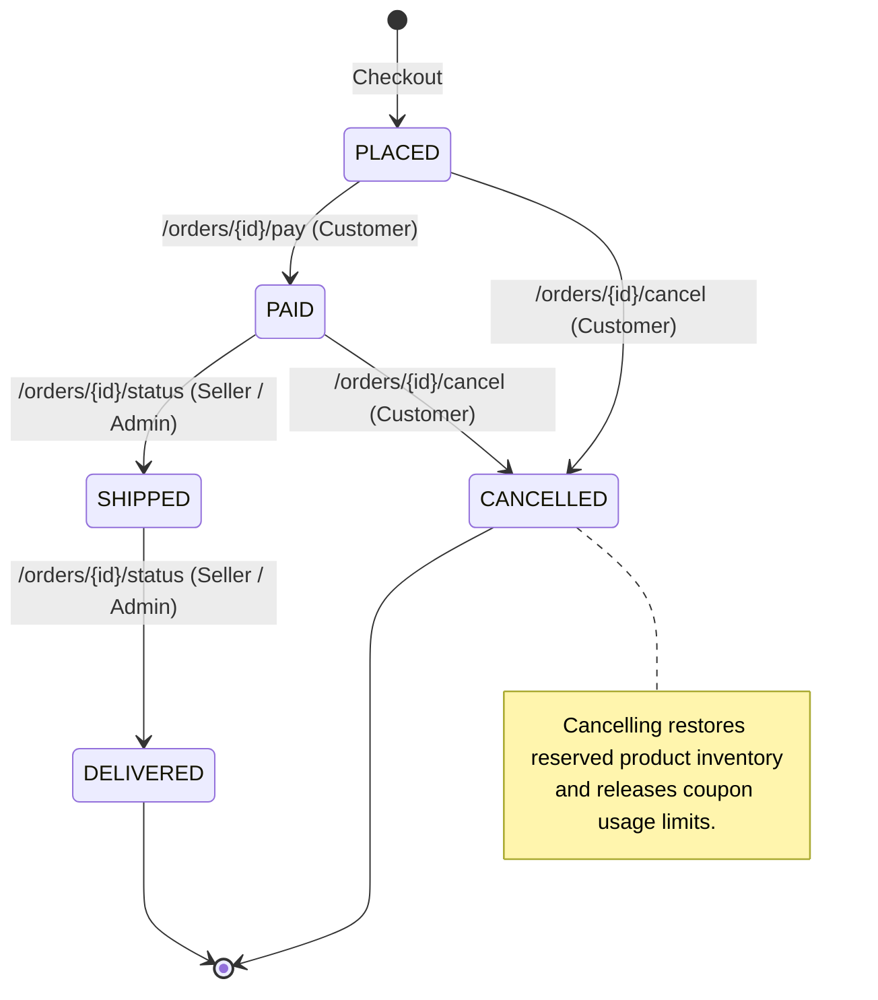

# MultiMart - Multi-Vendor E-Commerce Platform

[](https://github.com/Tejasgiri29/multivendor-ecommerce/actions/workflows/ci.yml)
[](https://spring.io/projects/spring-boot)
[](https://www.oracle.com/java/)
[](https://react.dev/)
[](https://vitejs.dev/)
[](https://www.postgresql.org/)
[](https://docs.docker.com/compose/)

A production-ready full-stack multi-vendor marketplace where independent **sellers** list and manage catalog items, **customers** browse, search, wish-list, apply discounts, buy and track orders, and **admins** moderate users, approve vendors, and govern platform categories and coupons.

---

## Table of Contents
1. [Overview & Tech Stack](#overview--tech-stack)
2. [Screenshots](#screenshots)
3. [Architecture](#architecture)
4. [Entity-Relationship Diagram](#entity-relationship-diagram)
5. [Features](#features)
6. [API Endpoints](#api-endpoints)
7. [Running with Docker](#running-with-docker)
8. [Running Locally](#running-locally)
9. [Default Credentials and Seed Data](#default-credentials-and-seed-data)
10. [How Stock Overselling is Prevented](#how-stock-overselling-is-prevented)
11. [Order Lifecycle](#order-lifecycle)
12. [How to Run Tests](#how-to-run-tests)
13. [Project Layout](#project-layout)
14. [Future Improvements](#future-improvements)

---

## Overview & Tech Stack

MultiMart is engineered as a resilient, high-concurrency multi-tenant marketplace designed with clean separation of concerns and database-level transactional integrity.

* **Backend:** Spring Boot 3.3 (Java 17, Maven)
  * Security: Spring Security 6 with stateless JWT Bearer authentication & BCrypt password hashing
  * Persistence: Spring Data JPA (Hibernate 6) & Flyway database migrations
  * API Documentation: springdoc-openapi (Swagger UI)
  * Concurrency: Atomic conditional database updates preventing race conditions and overselling
* **Frontend:** React 18 SPA + Vite
  * Routing & State: React Router v6, Context API for authentication & session management
  * HTTP Client: Axios with automatic JWT injection and 401 interceptors
  * Styling: Pure responsive CSS with modern layout principles
* **Database & Infrastructure:**
  * Database: PostgreSQL 16 (production/docker) and H2 in PostgreSQL compatibility mode for unit/integration testing
  * Reverse Proxy & Web Server: Nginx 1.27 Alpine (serves frontend static assets, reverse-proxies `/api` and `/swagger-ui` to backend)
  * Orchestration: Docker Compose multi-container setup with healthchecks

---

## Screenshots

| 1. Home / Product Catalog | 2. Product Detail |
|---|---|
|  |  |

| 3. Shopping Cart & Checkout | 4. Seller Dashboard |
|---|---|
|  |  |

| 5. Admin Moderation Dashboard | 6. Swagger API Documentation |
|---|---|
|  |  |

---

## Architecture

```mermaid
flowchart LR
    subgraph Client["Client Tier"]
        Browser["React 18 SPA<br/>(Vite, Axios, Router)"]
    end

    subgraph Gateway["Edge Tier (Docker :3000)"]
        Nginx["Nginx Reverse Proxy<br/>(:80 internal)"]
    end

    subgraph AppTier["Application Tier (Docker :8080)"]
        SpringBoot["Spring Boot 3.3 API<br/>(Stateless JWT Auth)"]
        Security["Spring Security Filter<br/>& ControllerAdvice"]
        Services["Business Services<br/>(Order, Cart, Coupon)"]
        Repositories["Spring Data JPA<br/>Repositories"]
    end

    subgraph DataTier["Data Tier (Docker :5432)"]
        Postgres[("PostgreSQL 16 DB<br/>Flyway Versioned Schema")]
    end

    Browser -->|HTTP Requests| Nginx
    Nginx -->|Static Assets| Browser
    Nginx -->|/api/* & /swagger-ui/*| SpringBoot
    SpringBoot --> Security
    Security --> Services
    Services --> Repositories
    Repositories -->|JDBC HikariCP| Postgres
```



The backend follows clean layered architecture:
- **`controller`**: REST controllers, request DTO validation (`@Valid`), role guards (`@PreAuthorize`).
- **`service`**: Transactional business logic, checkout orchestration, coupon computations, status transitions.
- **`repository`**: Spring Data JPA repositories with atomic `@Modifying` queries for stock and coupon limits.
- **`entity`**: Relational JPA entities mapped to Flyway-versioned tables.
- **`security`**: JWT parsing, claims extraction, user verification filter chain, password hashing.
- **`exception`**: Centralized `@RestControllerAdvice` delivering standardized JSON error responses.

---

## Entity-Relationship Diagram



---

## Features

### Everyone (Public & Guest)
- **Account Registration & Authentication:** Role selection (`CUSTOMER` or `SELLER`), BCrypt-hashed password storage, JWT issuance.
- **Catalog Browsing & Search:** Filter by keyword search, category, min/max price range, and sort by newest, price ascending/descending, or name.
- **Server-Side Pagination:** Efficient page and size pagination capped for high throughput.

### Customer
- **Persistent Shopping Cart:** Stock-aware quantity controls and automated stock validation.
- **Personal Wishlist:** Quick save and remove items for future purchases.
- **Coupon Validation & Preview:** Real-time preview of `PERCENT` and `FIXED` discounts against current cart subtotal with minimum order rules.
- **Checkout & Order Tracking:** Transactional checkout, simulated payment, order history overview, and order cancellation.
- **Automatic Stock Restoration:** Cancelling an order instantly restores reserved product inventory and releases coupon usage count.

### Seller
- **Product Management:** Full CRUD on own products (name, description, price, stock, category, image URL). Deletions perform a soft delete to preserve historical order records.
- **Seller Approvals:** New seller accounts require administrator approval before listings are published to the public catalog.
- **Vendor Order Overview:** Multi-vendor isolated view: sellers see only the line items belonging to their shop and can mark orders as `SHIPPED` or `DELIVERED`.

### Admin
- **User Moderation:** View all registered users, toggle enabled status (instantly invalidates active tokens), and approve seller accounts.
- **Category Governance:** Add, update, and remove categories (prevented with HTTP 409 if active products reference the category).
- **Coupon Campaign Management:** Create and manage percentage or fixed discount coupons with usage caps and expiration dates.
- **Global Order Moderation:** View all system orders and step them through lifecycle transitions.

---

## API Endpoints

Base path: `/api`. Interactive documentation: `http://localhost:8080/swagger-ui.html` (OpenAPI JSON: `/v3/api-docs`).

| Method | Endpoint | Required Role | Description |
|---|---|---|---|
| `POST` | `/api/auth/register` | Public | Register new `CUSTOMER` or `SELLER` account |
| `POST` | `/api/auth/login` | Public | Authenticate credentials and receive JWT |
| `GET` | `/api/auth/me` | Authenticated | Retrieve current user profile |
| `GET` | `/api/products` | Public | Search products (`keyword`, `categoryId`, `minPrice`, `maxPrice`, `sort`, `page`, `size`) |
| `GET` | `/api/products/{id}` | Public | Get product detail |
| `GET` | `/api/categories` | Public | List all categories |
| `GET` | `/api/cart` | CUSTOMER | View current shopping cart |
| `POST` | `/api/cart/items` | CUSTOMER | Add item to cart `{productId, quantity}` |
| `PUT` | `/api/cart/items/{productId}` | CUSTOMER | Update item quantity in cart |
| `DELETE` | `/api/cart/items/{productId}` | CUSTOMER | Remove item from cart |
| `DELETE` | `/api/cart` | CUSTOMER | Clear shopping cart |
| `GET` | `/api/wishlist` | CUSTOMER | View saved wishlist items |
| `POST` | `/api/wishlist/{productId}` | CUSTOMER | Add product to wishlist |
| `DELETE` | `/api/wishlist/{productId}` | CUSTOMER | Remove product from wishlist |
| `POST` | `/api/coupons/validate` | CUSTOMER | Validate and calculate coupon discount against cart |
| `POST` | `/api/orders/checkout` | CUSTOMER | Transactional checkout `{shippingAddress, couponCode}` |
| `GET` | `/api/orders` | CUSTOMER | List customer orders (paginated) |
| `GET` | `/api/orders/{id}` | Owner / Seller / ADMIN | Order detail |
| `POST` | `/api/orders/{id}/pay` | CUSTOMER | Simulate payment (`PLACED` -> `PAID`) |
| `POST` | `/api/orders/{id}/cancel` | CUSTOMER | Cancel order (restores inventory & coupon usage) |
| `PUT` | `/api/orders/{id}/status` | SELLER / ADMIN | Update order status |
| `GET` | `/api/seller/products` | SELLER | List seller's own products |
| `POST` | `/api/seller/products` | SELLER (Approved) | Create product |
| `PUT` | `/api/seller/products/{id}` | SELLER (Owner) | Update product |
| `DELETE` | `/api/seller/products/{id}` | SELLER (Owner) | Soft-delete product |
| `GET` | `/api/seller/orders` | SELLER | List orders containing seller's items |
| `POST` | `/api/admin/categories` | ADMIN | Create new category |
| `PUT` | `/api/admin/categories/{id}` | ADMIN | Update existing category |
| `DELETE` | `/api/admin/categories/{id}` | ADMIN | Delete category (fails if products exist) |
| `GET` | `/api/admin/coupons` | ADMIN | List all promotional coupons |
| `POST` | `/api/admin/coupons` | ADMIN | Create new coupon |
| `PUT` | `/api/admin/coupons/{id}` | ADMIN | Update coupon properties |
| `DELETE` | `/api/admin/coupons/{id}` | ADMIN | Delete coupon |
| `GET` | `/api/admin/users` | ADMIN | List all registered users |
| `PUT` | `/api/admin/users/{id}/enabled` | ADMIN | Enable or disable user account |
| `POST` | `/api/admin/users/{id}/approve-seller` | ADMIN | Approve pending seller account |
| `GET` | `/api/admin/orders` | ADMIN | View all platform orders |

---

## Running with Docker

Requirements: Docker and Docker Compose v2.

1. **Clone and setup environment variables:**
   ```bash
   cp .env.example .env
   ```
2. **Build and start the application containers:**
   ```bash
   docker compose up --build -d
   ```
3. **Access the application:**
   - **Frontend Web App:** [http://localhost:3000](http://localhost:3000)
   - **Backend REST API:** [http://localhost:8080/api](http://localhost:8080/api)
   - **Swagger UI:** [http://localhost:8080/swagger-ui/index.html](http://localhost:8080/swagger-ui/index.html) (or [http://localhost:3000/swagger-ui/index.html](http://localhost:3000/swagger-ui/index.html) through Nginx)

4. **Stop containers:**
   ```bash
   docker compose down
   # To clean database volumes as well:
   docker compose down -v
   ```

---

## Running Locally

### Prerequisites
- JDK 17+
- Apache Maven 3.8+
- Node.js 18+ and npm
- PostgreSQL 16 (or Docker container for database)

### Steps
1. **Start PostgreSQL database:**
   ```bash
   docker run -d --name shop-db -p 5432:5432 \
     -e POSTGRES_DB=shop \
     -e POSTGRES_USER=shop \
     -e POSTGRES_PASSWORD=shop \
     postgres:16-alpine
   ```
2. **Run Spring Boot Backend:**
   ```bash
   cd backend
   mvn spring-boot:run
   ```
   *Runs on port 8080. Automatically applies Flyway schema migrations and seeds demo data.*

3. **Run React Frontend:**
   ```bash
   cd frontend
   npm install
   npm run dev
   ```
   *Runs on port 5173. Vite dev server proxies `/api` calls directly to `http://localhost:8080`.*

---

## Default Credentials and Seed Data

When `SEED_ENABLED=true` (default), the `DataSeeder` seeds initial accounts, categories, sample products, and promo coupons:

| Role | E-mail | Password | Account Details |
|---|---|---|---|
| **ADMIN** | `admin@shop.com` | `Admin@123` | Platform Administrator |
| **SELLER** | `seller@shop.com` | `Seller@123` | Approved vendor with sample catalog listings |
| **SELLER** | `seller2@shop.com` | `Seller@123` | Unapproved vendor (for testing admin approval flow) |
| **CUSTOMER** | `customer@shop.com` | `Customer@123` | Regular shopper |

**Seeded Promo Coupons:**
- `WELCOME10`: 10% off (min. order: $20.00, limit: 1000 uses)
- `SAVE5`: $5.00 flat discount (min. order: $30.00)

---

## How Stock Overselling is Prevented

A naive "check stock, then update" implementation suffers from race conditions: two concurrent checkouts reading `stock = 1` will both proceed, leaving the database negative (`stock = -1`).

MultiMart eliminates overselling through **atomic, conditional database updates** at the SQL engine level:

```java
@Modifying
@Query("update Product p set p.stock = p.stock - :qty where p.id = :id and p.stock >= :qty")
int decrementStock(@Param("id") Long id, @Param("qty") int qty);
```

### Concurrency Guarantees
1. **Row-Level Mutex:** The database evaluates `stock >= :qty` under an exclusive row lock. Concurrent transactions attempting to purchase the same product are serialized.
2. **Deterministic Lock Ordering:** In `OrderService.checkout`, cart line items are sorted by `productId` ascending before locks are acquired, preventing distributed deadlocks between concurrent multi-item transactions.
3. **Atomic Return Check:** If `decrementStock` returns `0` (insufficient inventory), the service throws `InsufficientStockException`.
4. **All-or-Nothing Rollback:** Propagating `InsufficientStockException` rolls back the surrounding `@Transactional` boundary—reverting any decrements on prior cart items, rolling back coupon usage, and preserving the user's cart intact.
5. **Database Constraint Safety Net:** A PostgreSQL `CHECK (stock >= 0)` constraint guarantees inventory never becomes negative under any circumstance.
6. **Cancellation Restoration:** Order cancellation (`/cancel`) atomically increments stock (`incrementStock`) and restores coupon availability within a single database transaction.

*Verified under high concurrency in `StockIntegrationTest`: 12 simultaneous threads racing for 5 inventory items cleanly produce exactly 5 completed checkouts and 7 rejected transactions, leaving final stock at exactly 0.*

---

## Order Lifecycle



---

## How to Run Tests

### Backend Unit & Integration Tests
All backend tests execute against an in-memory H2 database running in PostgreSQL compatibility mode—**no running PostgreSQL or Docker instance is required**. Flyway migrations and Hibernate entity validations are verified as part of the test suite.

```bash
cd backend
mvn -B clean test
```

To build the executable production jar:
```bash
mvn -B clean package -DskipTests
```

### Frontend Build Verification
```bash
cd frontend
npm ci
npm run build
```

---

## Project Layout

```
multivendor-ecommerce/
├── .github/
│   └── workflows/
│       └── ci.yml                     # GitHub Actions CI workflow (Java 17 test + Node 20 build)
├── docs/
│   └── screenshots/                   # Application screenshots
├── backend/
│   ├── pom.xml                        # Maven dependencies & configuration
│   ├── Dockerfile                     # Multi-stage Temurin JRE build
│   └── src/
│       ├── main/
│       │   ├── java/com/example/shop/
│       │   │   ├── config/            # SecurityConfig, DataSeeder, OpenAPI
│       │   │   ├── controller/        # REST endpoints & request routing
│       │   │   ├── dto/               # Strongly-typed Java Records & validation
│       │   │   ├── entity/            # JPA entities & Enums
│       │   │   ├── exception/         # Centralized error handling & RestControllerAdvice
│       │   │   ├── repository/        # Spring Data repositories & atomic queries
│       │   │   ├── security/          # JWT tokens, auth filter, UserPrincipal
│       │   │   └── service/           # Business logic & transactional operations
│       │   └── resources/
│       │       ├── application.yml    # App configuration & datasource properties
│       │       └── db/migration/      # Flyway SQL migrations
│       └── test/                      # Mockito and Spring Boot integration tests
├── frontend/
│   ├── package.json                   # React 18, Vite, Axios, React Router
│   ├── vite.config.js                 # Vite build & proxy settings
│   ├── nginx.conf                     # Production SPA & reverse-proxy configuration
│   ├── Dockerfile                     # Multi-stage Node build + Nginx Alpine
│   └── src/
│       ├── components/                # Navbar, ProductCard, Pagination, ProtectedRoute
│       ├── pages/                     # Products, Detail, Cart, Checkout, Dashboards
│       ├── AuthContext.jsx            # Authentication state provider
│       └── api.js                     # Axios instance & token interceptors
├── docker-compose.yml                 # Multi-container orchestration (postgres, backend, frontend)
├── .env.example                       # Template for environment configuration
└── README.md                          # Project documentation
```

---

## Future Improvements

1. **Payment Gateway Integration:** Integrate Stripe / PayPal webhooks for real payment authorization and capture.
2. **Vendor Payouts & Split Orders:** Support split orders with distinct fulfillment lifecycles and Stripe Connect vendor payouts.
3. **Advanced Search & Catalog Indexing:** Replace `LIKE` queries with PostgreSQL full-text search (`tsvector` & GIN indexes) or Elasticsearch/Meilisearch.
4. **Cloud Storage for Media:** Replace external image URLs with AWS S3 / Cloudflare R2 presigned image upload endpoints.
5. **Distributed Caching:** Add Redis caching for high-read catalog endpoints and category hierarchies.
6. **Token Hardening:** Shift JWT storage from `localStorage` to secure, HTTP-only SameSite cookies with a refresh-token rotation scheme.
